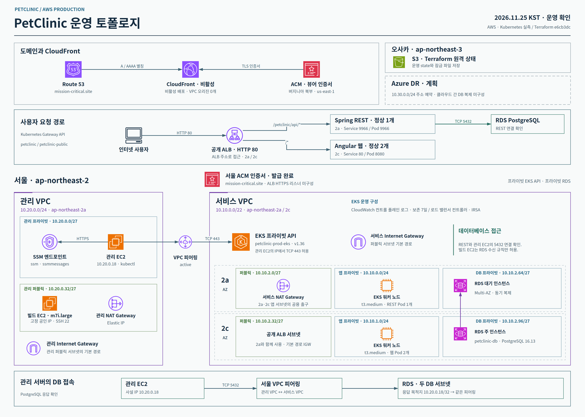

# PetClinic 인프라

PetClinic은 AWS 서울 리전의 EKS에서 Angular 웹과 Spring REST API를 실행하고, 진료 데이터를 RDS PostgreSQL에 저장한다. 이 저장소의 Terraform 실행 루트는 `infra/envs/aws-prod/`다. [AWS 운영 가이드](infra/envs/aws-prod/README.md) · [애플리케이션 저장소](https://github.com/bespinglobal-finalproject-kdt5/petclinic-eks-app)

## 운영 토폴로지

**2026년 11월 25일 운영 확인 당시 앱 진입점은 서울의 인터넷 공개 ALB(HTTP 80)였다.** 아래 도면과 표에는 그날 확인한 워크로드 수, 연결 경로, DB 상태를 기록했다. 서비스 도메인 `mission-critical.site`는 당시 비활성 CloudFront 배포를 가리켰다.

[편집용 draw.io](docs/architecture/production-topology.drawio) · [경로별 설명과 확인 근거](docs/architecture/production-topology.md)

| 구성 | 운영 상태 |
|---|---|
| 사용자 요청 | Kubernetes Gateway가 공개 ALB를 관리한다. `/petclinic/api`와 그 하위 경로는 REST Pod 1개(9966), 나머지 경로는 웹 Pod 2개(8080)로 전달한다. ALB 대상 3개 모두 정상이다. |
| 서울 서비스 VPC · `10.10.0.0/22` | 2a·2c에 퍼블릭·앱·DB 서브넷을 배치했다. 프라이빗 EKS 1.36 워커는 AZ마다 한 대이며, 앱 서브넷은 2a NAT를 공유한다. REST Pod에서 운영 RDS로 맺어진 TCP 5432 연결을 확인했다. |
| RDS · `petclinic-db` | 비공개 PostgreSQL 16.13 Multi-AZ 인스턴스다. 확인 시점의 주 DB는 2c, 대기는 2a다. 자동 백업 보존 기간은 0일이고 논리 복제는 꺼져 있다. |
| 서울 관리 VPC · `10.20.0.0/24` | 프라이빗 관리 EC2는 피어링으로 EKS API(443)와 RDS(5432)에 접근한다. DB 서브넷 두 개는 관리 EC2 `10.20.0.18/32`로 응답을 돌려보낸다. 퍼블릭 빌드 EC2는 EIP를 사용하며, 두 EC2 모두 SSM에 온라인으로 등록돼 있다. |
| DNS·인증서 | Route 53 A·AAAA 별칭은 CloudFront를 가리킨다. VPC 오리진은 0개다. 버지니아 북부의 뷰어 인증서는 CloudFront에 연결돼 있고, 서울 인증서는 발급됐지만 ALB에는 HTTP 리스너만 있다. |
| 운영 state·Azure DR | AWS 운영 state는 서울 S3, Azure DR state는 Korea Central의 전용 Blob 컨테이너에 각각 저장한다. Azure PoC 코드는 예약 대역 안의 `10.30.0.0/25`를 사용한다. 운영 RDS에서 Azure로 가는 복제 경로는 별도 구성 대상이다. |

## Terraform 코드 위치

서울의 두 VPC, EKS, CloudFront는 하나의 운영 루트에서 연결한다. 모듈을 수정할 때도 `terraform plan`은 `infra/envs/aws-prod/`에서 실행한다. [모듈 연결](infra/envs/aws-prod/main.tf) · [서울 S3 backend](infra/envs/aws-prod/backend.tf)

| 변경할 대상 | 코드 위치 |
|---|---|
| 서비스 VPC·서브넷·NAT, RDS PostgreSQL | [seoul-vpc1-service/](infra/envs/aws-prod/seoul-vpc1-service/) |
| 관리 VPC, 빌드·관리 EC2와 SSM | [seoul-vpc2-management/](infra/envs/aws-prod/seoul-vpc2-management/) |
| EKS 클러스터·노드·애드온, 컨트롤러 IAM | [eks/](infra/envs/aws-prod/eks/) |
| CloudFront 배포·VPC Origin, Route 53·ACM (`module.cloudfront`) | [cloudfront/](infra/envs/aws-prod/cloudfront/) |
| VPC 피어링, 관리 EC2 → EKS·RDS, EKS → RDS 보안 그룹 규칙 | [connectivity/](infra/envs/aws-prod/connectivity/) |

## 작업별 문서

GitHub Actions는 `main` 대상 PR에서 Terraform 포맷·유효성·mock 테스트를 검사한다. 운영 담당자는 병합된 `main`에서 검토한 plan을 적용한다. 서브넷 ID는 운영 루트 출력에서, 리소스 역할은 `project`·`environment`·`component` 태그에서 확인한다.

| 작업 | 문서 |
|---|---|
| AWS 모듈 찾기, EKS·DB 담당자에게 서브넷 전달, CloudFront 연결 | [AWS 운영 가이드](infra/envs/aws-prod/README.md) |
| 빌드 서버 또는 관리 서버에 SSM으로 접속 | [서울 VPC 2 서버 및 접속 명령](infra/envs/aws-prod/seoul-vpc2-management/README.md) |
| CIDR·라우팅·태그 확인 | [서브넷과 EKS 연결 규칙](infra/envs/aws-prod/SUBNET-RULES.md) · [서비스 VPC를 /22로 정한 근거](infra/NETWORK.md#cidr-선정-근거) · [공통 태그](infra/TAGS.md) |
| 로컬 검사, PR, 운영 state 처리 | [팀 작업 절차](CONTRIBUTING.md) · [Terraform CI](.github/workflows/terraform-check.yml) · [공유 state 운영 기준](infra/STATE.md) |
| Azure DR 및 후속 설계 | [Azure DR PoC와 팀 접근](infra/envs/azure-dr/README.md) · [정적 웹·로그용 S3 설계안](docs/architecture/planned-s3-storage.md) |
